# Iliass Bouchari

**Systems and Networks Technician · Cybersecurity · Aspiring SOC analyst**

Student in Licence Cyber Security and Digital Trust (L-CSCN, S5) · 850+ PCs managed at CMC · El Jadida, Morocco

---

## About me

Plain-text version

Student in Licence Cyber Security and Digital Trust (L-CSCN, S5), Sep 2026 – Jun 2027, at the Faculté Polydisciplinaire de Sidi Bennour (FPSB), Université Chouaib Doukkali. I build on the OFPPT Technicien Spécialisé Infrastructure Digitale (Systèmes et Réseaux, 2024 – 2026) and Cisco CCNA 1-3. I like building and securing real infrastructure: Active Directory, Cisco networks, Fortinet firewalls and automation that saves time on the ground. Based in El Jadida, Casablanca-Settat, Morocco.

-  Managed **850+ PCs** on the CMC campus domain (Jan–Jun 2026)
-  Worked with **Fortinet, Cisco and Windows Server** during the CMC internship
-  Three **Cisco CCNA** levels, with verified Credly badges
-  Goal: **SOC analyst**, using **Wazuh** (SIEM)
-  English – B2 · French – A2
-  Reach me: [Bouchariliass@gmail.com](mailto:Bouchariliass@gmail.com)

## Tech stack

## Infrastructure and lab topology

*General diagram. At CMC I worked on Active Directory, GPO deployment and an introduction to FortiGate. Wazuh, Proxmox and Zabbix on it are lab items.*

## Experience, projects and labs

Plain-text version

**Experience**

| When | Where | What |
|---|---|---|
| 01 Jan – 24 Jun 2026 | Cité des Métiers et des Compétences Casablanca-Settat (CMC) | Stagiaire Technicien Systèmes & Réseaux. Campus domain, workstation hardening, GPO deployment, helpdesk |
| 08 Jul – 08 Oct 2025 | Cité des Métiers et des Compétences Casablanca-Settat (CMC) | Stagiaire en Gestion et Bureautique. Admissions (1200+ candidates), Word/Excel, first-level support. Not a systems and networks internship |
| 01 Jul – 31 Aug 2024 | KAEFER | Systèmes et Réseaux, observation internship |

**Projects and labs**

- **Active Directory domain for the CMC campus:** one domain, OUs per sector and room, a naming scheme for every workstation.
- **PowerShell domain-join automation:** a USB script sets DNS, renames the PC and joins the domain. About 20 min down to under 3 per PC.
- **Software deployment with GPO:** silent MSI/EXE installs per sector, Office 365 removal and Office 2016 rollout.
- **Workstation security hardening:** WinRE and CMD access blocked, HP BIOS passwords and local accounts managed by script and GPO.
- **FortiGate firewall introduction:** FortiOS interface, logs, security policies and dashboard.

Write-ups are on the [portfolio](https://iliassbouchari.github.io).

## GitHub activity

---

